# 개발 워크스테이션 구축

## 1. 프로젝트 개요
- 터미널, Docker, Git/GitHub를 사용해 재현 가능한 개발 환경 구축

## 2. 실행 환경
- OS: Windows_NT
- Shell: 5.1.26100.9711
- Docker version: 29.9.2, build a82e528
- Git version: 2.56.0.windows.4

## 3. 수행 항목 체크리스트
- [ ] 터미널 기본 조작
- [ ] 파일/디렉토리 권한 실습
- [ ] Docker 설치 및 점검
- [ ] Docker 기본 운영 명령
- [ ] hello-world 실행
- [ ] ubuntu 컨테이너 진입
- [ ] Dockerfile 기반 커스텀 이미지 빌드
- [ ] 포트 매핑 접속 확인
- [ ] 바인드 마운트 반영 확인
- [ ] Docker 볼륨 영속성 확인
- [ ] Git 설정
- [ ] GitHub/VSCode 연동

## 4. 터미널 조작 로그
Get-Location(현재위치 확인)

ls -Force(목록확인) *Get-ChildItem -Force
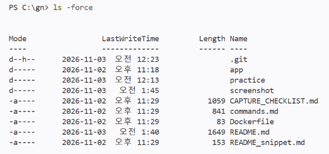

Set-Location 폴더명(이동) *cd 폴더명
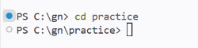
*상위 폴더로 이동은 cd ..
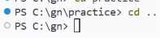

New-Item -ItemType Directory 폴더명(폴더 만들기)

New-Item -ItemType File 파일명(파일 만들기)
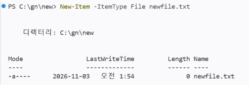

Copy-Item a b (복사)
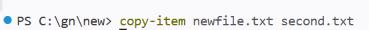
폴더 안의 내용까지 복사는 뒤에  -Recurse를 붙인다

Move-Item 원본 대상경로(이동)
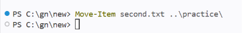

Rename-Item 기존이름 새이름(이름변경)
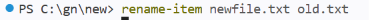

Remove-Item 파일명(삭제)

Get-Content 파일명(파일 내용 확인) *cat 파일명
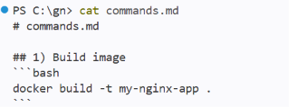

New-Item -ItemType File 파일명(빈 파일 생성)

## 5. 권한 실습
icacls(권한 확인)

/grant:r(권한 변경)
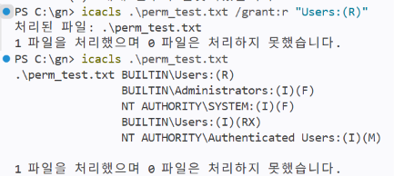

## 6. Docker 설치 및 점검
docker --version

docker info
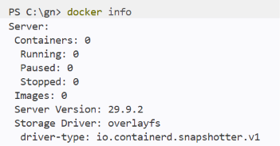

## 7. Docker 기본 운영 명령

docker run hello-world

docker images
docker ps -a

docker run -it ubuntu bash
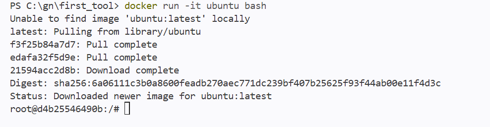

ls, echo exit
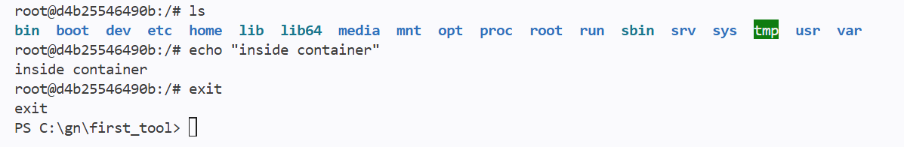

docker run -d --name my-nginx-container -p 8080:80 
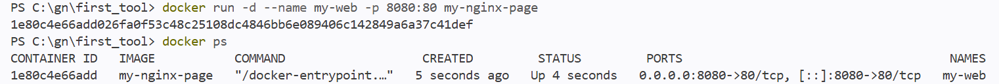

curl http://localhost:8080 

docker volume create my-nginx-data
docker run -d --name my-nginx-volume -p 8082:80   -v my-nginx-data:/usr/share/nginx/html   nginx:alpine

## 8. 커스텀 이미지 제작
## 9. 포트 매핑 검증
## 10. 바인드 마운트 검증
## 11. Docker 볼륨 영속성 검증
## 12. Git 설정 및 GitHub 연동
## 13. 트러블슈팅
## 14. 핵심 개념 정리