# 개발 워크스테이션 구축

## 1. 프로젝트 개요
터미널, Docker, Git/GitHub를 사용해 재현 가능한 개발 환경 구축

---

## 2. 실행 환경

| 항목 | 내용 |
|---|---|
| OS | Windows_NT |
| Shell | 5.1.26100.9711 |
| Docker version | 29.9.2, build a82e528 |
| Git version | 2.56.0.windows.4 |

### 2-1 프로젝트 디렉토리 구조
```
first_tool/
├─ README.md
├─ Dockerfile
├─ app/
   └─ index.html
└─ assets/
```
해당 프로젝트는 나누어 저장해야 할 자료가 적기 때문에 디렉토리의 구성을 간결하게 진행하였다
- 'assets/' 출력할 실행 증거 이미지모음
- 'app/' index 파일

디렉토리 설계기준은 대략 아래와 같다

- 기능별 분리: 파일을 용도에 따라 나누기
- 재사용성 고려: 공통 자료는 따로 모아주기
- 유지보수성: 찾기 쉽고 수정하기 쉽게 
- 확장성 확보: 파일이 늘어나도 구조가 무너지지 않도록

---

## 3. 수행 항목 체크리스트

- [x] 터미널 기본 조작
- [x] 파일/디렉토리 권한 실습
- [x] Docker 설치 및 점검
- [x] Docker 기본 운영 명령
- [x] hello-world 실행
- [x] ubuntu 컨테이너 진입
- [x] Dockerfile 기반 커스텀 이미지 빌드
- [x] 포트 매핑 접속 확인
- [x] 바인드 마운트 반영 확인
- [x] Docker 볼륨 영속성 확인
- [x] Git 설정
- [x] GitHub/VSCode 연동

---

## 4. 터미널 조작 로그

### 4-1. 현재위치 확인
```powershell
Get-Location
```

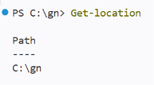

### 4-2. 목록 확인
```powershell
ls -Force
```
`Get-ChildItem -Force`


### 4-3. 폴더 이동
```powershell
Set-Location 폴더명
```
`cd 폴더명`


상위 폴더로 이동:
```powershell
cd ..
```


### 4-4. 폴더 만들기
```powershell
New-Item -ItemType Directory 폴더명
```

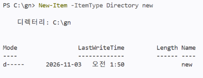

### 4-5. 파일 만들기
```powershell
New-Item -ItemType File 파일명
```


### 4-6. 복사
```powershell
Copy-Item a b
```


폴더 안의 내용까지 복사할 때는 뒤에 `-Recurse`를 붙인다.

### 4-7. 이동
```powershell
Move-Item 원본 대상경로
```


### 4-8. 이름변경
```powershell
Rename-Item 기존이름 새이름
```


### 4-9. 삭제
```powershell
Remove-Item 파일명
```

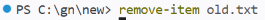

### 4-10. 파일 내용 확인
```powershell
Get-Content 파일명
```
`cat 파일명`


### 4-11. 빈 파일 생성
```powershell
New-Item -ItemType File 파일명
```

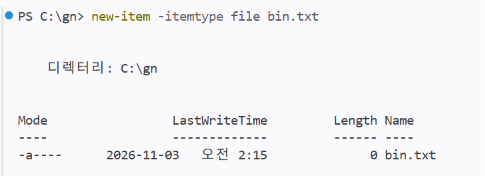

---

## 5. 권한 실습

### 5-1. 권한 확인
```powershell
icacls
```

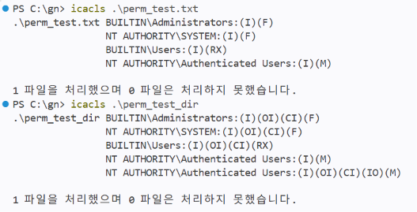

### 5-2. 권한 변경
```powershell
/grant:r
```


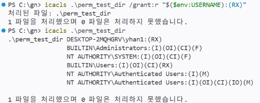

---

## 6. Docker 설치 및 점검

### 6-1. 버전확인
```bash
docker --version
```

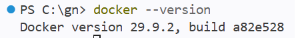

### 6-2. 동작여부확인
```bash
docker info
```


### 6-3. 빌드 실행
```bash
docker build -t nginx-alpine .
```

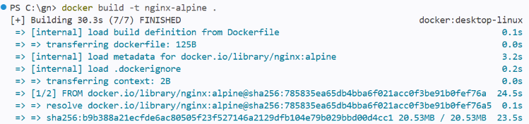

---

## 7. Docker 기본 운영 명령

### 7-1. hello-world 실행
```bash
docker run hello-world
```

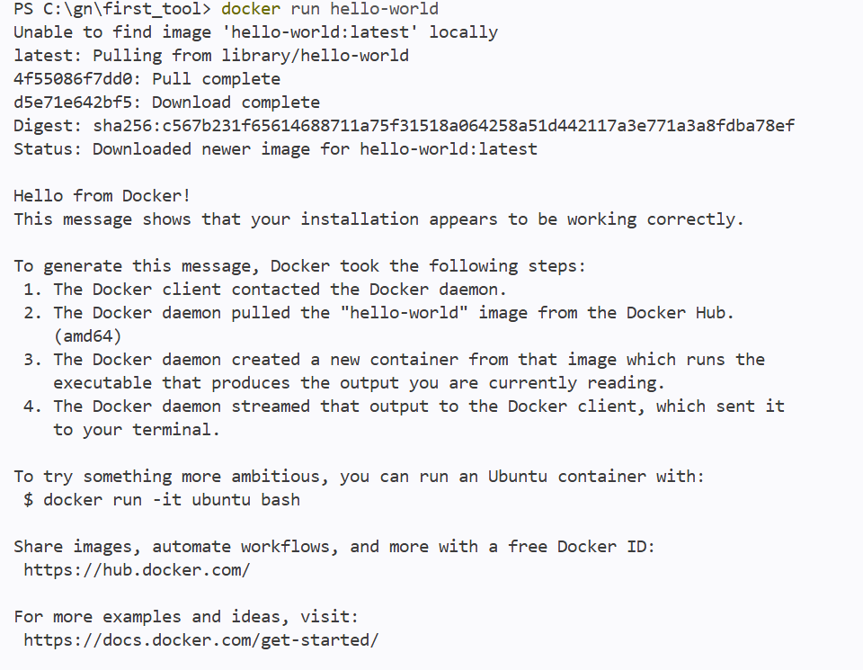

### 7-2. 이미지 및 컨테이너 목록 확인
```bash
docker images
docker ps -a
```

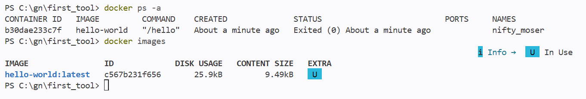

### 7-3. ubuntu 컨테이너 실행 및 진입
```bash
docker run -it ubuntu bash
```


### 7-4. 컨테이너 진입 후 간단 명령
```bash
ls
echo exitcur
```


### 7-5. 포트매핑 실행명령
```bash
docker run -d --name my-nginx-container -p 8080:80
```


---

## 8. 포트 매핑 접속증거

### 8-1. 호스트 포트 접속
```bash
curl http://localhost:8080
```

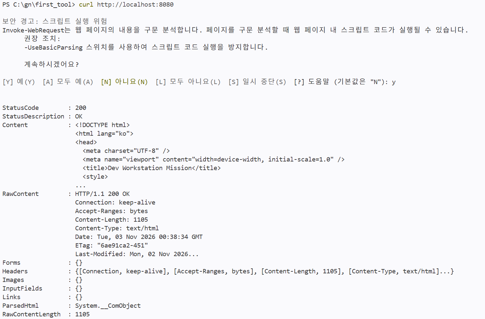

---

## 9. Docker 볼륨 영속성 검증

### 9-1. 볼륨 생성 및 마운트
```bash
docker volume create my-nginx-volume
docker run -d --name my-nginx-container -p 8082:80 -v my-nginx-volume:/usr/share/nginx/html nginx:alpine
```

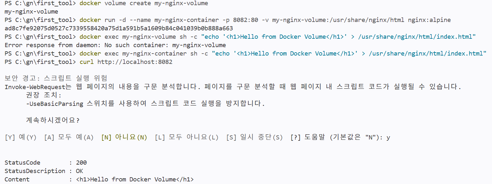

### 9-2. 컨테이너 삭제 후 데이터 유지 확인
```bash
docker stop my-nginx-container
docker rm my-nginx-container
docker volume ls
docker run -d --name my-nginx-new -p 8082:80 -v my-nginx-volume:/usr/share/nginx/html nginx:alpine
docker exec my-nginx-new cat /usr/share/nginx/html/index.html
```

- `docker stop my-nginx-container` : 컨테이너 중지
- `docker rm my-nginx-container` : 컨테이너 삭제
- `docker volume ls` : 볼륨 확인
- `docker run -d --name my-nginx-new -p 8082:80 -v my-nginx-volume:/usr/share/nginx/html nginx:alpine` : 같은 볼륨으로 새 컨테이너 생성
- `docker exec my-nginx-new cat /usr/share/nginx/html/index.html` : 파일이 그대로 있는지 확인

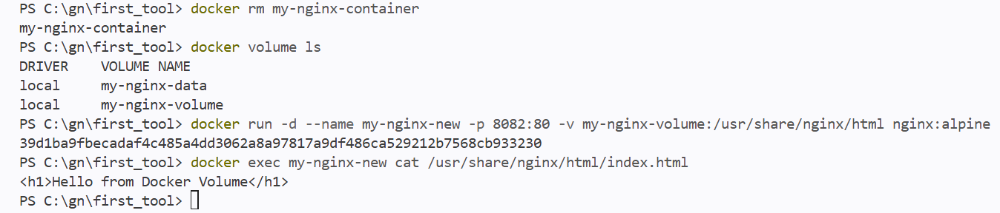

---

## 10. Git 설정 및 GitHub 연동
### Git 설정
```bash
git config --global user.name
git config --global user.email
git config --global init.defaultBranch main
```
### GitHub 원격 저장소 연결
```
git remote add origin https://github.com/username/repository.git
git remote -v
```
### 커밋 및 푸시
```
git add .
git commit -m "commit message"
git push -u origin main
```

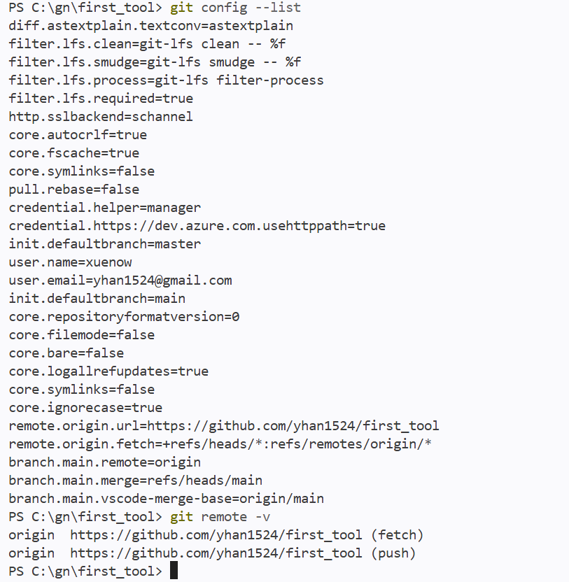

## 12. Image and Container

### 이미지와 컨테이너의 차이
- **이미지(Image)**: 컨테이너를 만들기 위한 실행 템플릿입니다.
- **컨테이너(Container)**: 이미지를 실행한 실제 동작 인스턴스입니다.
- 이미지는 저장된 상태이고, 컨테이너는 실행 중인 상태입니다.

### 빌드 → 실행 → 변경 흐름
1. `Dockerfile`을 작성한다.
2. `docker build`로 이미지를 생성한다.
3. `docker run`으로 컨테이너를 실행한다.
4. 컨테이너 내부에서 파일을 변경하면, 그 변경은 기본적으로 해당 컨테이너에만 반영된다.
5. 변경 내용을 보존하려면 다시 이미지로 빌드하거나 볼륨을 사용해야 한다.

### 정리 표
| 구분 | 의미 | 특징 |
|---|---|---|
| 이미지 | 실행 설계도 | 저장된 상태 |
| 컨테이너 | 실행 결과 | 동작 중인 상태 |
| 변경 | 컨테이너 내부 수정 | 기본적으로 임시 |

---

## 13. Network Namespace and Port Forwarding

### 네트워크 네임스페이스
컨테이너는 호스트와 분리된 네트워크 네임스페이스를 사용하므로, 기본적으로 외부에서 바로 접근할 수 없습니다.

### `-p` 포트 포워딩
`-p` 옵션은 호스트 포트를 컨테이너 포트에 연결해 외부에서 접근할 수 있게 해줍니다.

### 예시
```bash
docker run -p 8080:80 myimage
```

- 호스트의 `8080` 포트
- 컨테이너의 `80` 포트

---

## 14. Absolute vs Relative Path

### 절대경로와 상대경로
- **절대경로**: 루트(`/`)부터 시작하는 고정 경로
- **상대경로**: 현재 작업 위치를 기준으로 하는 경로

### 사용 기준
- 정확한 위치를 항상 유지해야 하면 → **절대경로**
- 현재 위치 기준으로 유연하게 이동할 때 → **상대경로**
- 자동화 스크립트에서는 경로 혼동을 줄이기 위해 절대경로가 유리한 경우가 많다.
- 개발 중 빠르게 이동하며 작업할 때는 상대경로가 편리하다.

### 예시
```bash
/home/user/project/data.txt   # 절대경로
./data.txt                    # 상대경로
../data.txt                   # 상대경로
```

---

## 15. rwx Permission Mapping

### 권한 비트 의미
- `r` = read(읽기)
- `w` = write(쓰기)
- `x` = execute(실행)

### 숫자 매핑
| 권한 | 값 |
|---|---:|
| r | 4 |
| w | 2 |
| x | 1 |

### 조합 예시
| 권한 | 숫자 | 의미 |
|---|---:|---|
| rwx | 7 | 읽기 / 쓰기 / 실행 |
| rw- | 6 | 읽기 / 쓰기 |
| r-x | 5 | 읽기 / 실행 |
| r-- | 4 | 읽기 |
| --- | 0 | 권한 없음 |

### `755` 예시
- 소유자: `7` = `rwx`
- 그룹: `5` = `r-x`
- 기타: `5` = `r-x`

```bash
chmod 755 script.sh
ls -l script.sh
```

---

## 16. Port Conflict Troubleshooting

### 포트 충돌 진단 순서
1. 포트가 사용 중인지 확인한다.
2. 해당 포트를 점유한 프로세스를 찾는다.
3. 필요하면 프로세스를 종료한다.
4. 다시 실행해서 문제가 해결되었는지 확인한다.

### 포트 사용 확인
```bash
lsof -i :8080
```

### 예시 출력
```text
COMMAND   PID USER   FD   TYPE DEVICE SIZE/OFF NODE NAME
python3  1234 user    3u  IPv4  ...        TCP *:8080 (LISTEN)
```

### 프로세스 종료
```bash
kill 1234
```

강제 종료가 필요할 경우:
```bash
kill -9 1234
```

### 재확인
```bash
lsof -i :8080
```

### 정리
- 확인 → 식별 → 종료 → 재확인 순서로 기록한다.
- 실제 실행 로그를 함께 첨부하면 신뢰도가 높아진다.

---

## 17. Bind Mount vs Docker Volume

### 비교 표
| 항목 | 바인드 마운트 | Docker 볼륨 |
|---|---|---|
| 연결 방식 | 호스트 경로를 직접 연결 | Docker가 관리하는 저장소 사용 |
| 장점 | 개발 중 즉시 반영됨 | 관리가 편하고 이식성이 좋음 |
| 단점 | 호스트 경로에 의존함 | 호스트에서 직접 보기 어려울 수 있음 |
| 적합한 경우 | 개발 / 디버깅 | 운영 / 데이터 보존 |

### 간단 설명
- **바인드 마운트**는 로컬 파일을 컨테이너에 바로 연결하는 방식이다.
- **Docker 볼륨**은 Docker가 데이터를 관리하므로 운영 환경에서 사용하기 좋다.

### 예시
```bash
# 바인드 마운트
docker run -v $(pwd)/data:/app/data myimage

# Docker 볼륨
docker run -v myvolume:/app/data myimage
```

---

## 18. Troubleshooting Case

### 사례: 컨테이너 포트 접속 실패

#### 1) 가설
호스트의 해당 포트가 이미 사용 중이라 컨테이너 실행 또는 접속이 실패했을 것이다.

#### 2) 확인
```bash
lsof -i :8080
```

### 예시 출력
```text
COMMAND   PID USER   FD   TYPE DEVICE SIZE/OFF NODE NAME
node     4321 user    18u  IPv4  ...        TCP *:8080 (LISTEN)
```

#### 3) 조치
```bash
kill 4321
docker run -p 8080:80 myimage
```

#### 4) 결과
브라우저에서 `http://localhost:8080` 접속이 정상적으로 동작했다.

### 기록 형식
- 문제 상황
- 가설
- 검증 명령어
- 출력 로그
- 조치 내용
- 최종 결과

---